<p align="center">
  
</p>

<p align="center">
  
</p>

<p align="center">
  <a href="#how-to-use-it"><b>Get started&nbsp;›</b></a>
  &nbsp;&nbsp;&nbsp;
  <a href="#is-it-safe"><b>Is it safe?&nbsp;›</b></a>
  &nbsp;&nbsp;&nbsp;
  <a href="#how-it-works"><b>How it works&nbsp;›</b></a>
</p>

<p align="center">
  
</p>

<p align="center">
  
</p>

## What it deletes

<p align="center">
  
</p>

Want to keep some? Filters keep tweets by date, by likes, by words, or by link.

## How to use it

You need a desktop browser: Chrome, Edge, Brave, Firefox or another Chromium browser.

1. **Open [x.com](https://x.com)** and log in to the account you want to clean.
2. **Open the console.** Press <kbd>F12</kbd> and click the **Console** tab. Or use <kbd>Ctrl</kbd> <kbd>Shift</kbd> <kbd>J</kbd> on Windows and Linux, <kbd>Cmd</kbd> <kbd>Option</kbd> <kbd>J</kbd> on a Mac.
3. **Allow pasting.** The first time, Chrome blocks pasting as a safety measure. Type `allow pasting` and press <kbd>Enter</kbd>.
4. **Copy the script.** Open [`tweet-wiper.js`](tweet-wiper.js), click **Raw**, then press <kbd>Ctrl</kbd> <kbd>A</kbd> and <kbd>Ctrl</kbd> <kbd>C</kbd>.
5. **Paste it** into the console and press <kbd>Enter</kbd>. The Tweet Wiper panel appears in the top right corner.
6. **Press Scan my profile.** It lists your posts, replies and reposts straight from X.
7. **Check what goes.** Set filters if you like, press **Preview**, or press **Download list (CSV)** to keep a spreadsheet of it.
8. **Press Delete** and confirm.

That's it. Leave the tab open. When a batch is done it rescans your profile and keeps going until nothing that matches your filters is left.

https://github.com/user-attachments/assets/538614d2-20d2-4a83-9ea7-7488de324efa

> [!WARNING]
> Deleting is permanent and X has no undo. If you might want your tweets later, [download your X archive](#old-tweets-and-your-archive) first.

## How long it takes

https://github.com/user-attachments/assets/9d9ecf18-7fe6-4b31-a41c-ffd1c152a42f

About 800 an hour: **1,000** tweets take about 1.5 hours, **5,000** about 7 hours, **20,000** about a day. Keep the tab open and the computer awake.

## Is it safe?

- **It can't see your login.** X keeps your login cookie where page scripts can't read it, including this one.
- **It only talks to x.com.** No outside scripts, no tracking. The long token in the file is X's own public web token, the same for every visitor.
- **Tweaks can't redirect it.** Only the number settings below can be changed from outside.
- **Your risk.** X's terms discourage automation. Tweet Wiper keeps to the pace X allows, which is what keeps accounts from being flagged.

> [!CAUTION]
> Only paste code you've read or that comes from this repository. A modified copy pasted into your console can take over your account. Never share your cookies or what your console shows.

<details>
<summary><b>Stopping and resuming</b></summary>
<br>

Press **Stop** at any time. The panel remembers in your browser which tweets it already deleted. To carry on later, paste the script again, press **Scan my profile**, then **Delete**. Finished tweets are skipped.

</details>

<a id="old-tweets-and-your-archive"></a>
<details>
<summary><b>Old tweets and your archive</b></summary>
<br>

X doesn't always list every old tweet on your profile. To catch everything:

1. On X go to **Settings and privacy → Your account → Download an archive of your data**. It can take up to a day to arrive.
2. Unzip it.
3. In the panel press **Load archive file** and pick `data/tweets.js`. Large accounts also have `tweets-part1.js`, `tweets-part2.js` and so on; select them all.

The archive is also your backup. Keep it, because deleting can't be undone.

</details>

<details>
<summary><b>Troubleshooting</b></summary>
<br>

| You see | What to do |
| --- | --- |
| No panel after pasting | Wait until x.com has fully loaded, reload the page and paste again. |
| "Can't tell which account is logged in" | Log in to x.com and wait for the home page to load. |
| "X turned down the request" | It looks up X's latest internal ids by itself. If that fails, it switches to clicking through X's own menus, which is slower but works the same. |
| "X says you're logged out" | Log in again, paste the script and press Delete. Finished tweets are remembered. |
| "15 failures in a row, so it paused" | Check that x.com works in another tab, then press Resume. |
| Profile count doesn't reach 0 | X's post count lags behind and sometimes counts deleted tweets. Check the Posts, Replies and Reposts tabs instead. |

</details>

<details>
<summary><b>Tweaks</b></summary>
<br>

Before pasting the script you can change its pacing. For example:

```js
window.tweetWiperConfig = { minDelayMs: 3000, maxDelayMs: 6000 }
```

| Setting | Default | Meaning |
| --- | --- | --- |
| `minDelayMs`, `maxDelayMs` | 1500, 3500 | Random pause between deletes |
| `stopAtRemaining` | 5 | Rest once X reports this few deletes left in its window |
| `batchSize`, `batchRestMin` | 180, 16 | When X sends no limit info, rest this many minutes after this many deletes |
| `timeoutMs` | 20000 | Give up on a request after this long |

Only these number settings are read. Anything else in `tweetWiperConfig` is ignored.

</details>

## How it works

https://github.com/user-attachments/assets/e429d8f2-be35-40a9-94c5-4ae45356ca56

<details>
<summary><b>The details</b></summary>
<br>

- **Listing:** X's website loads each profile tab (Posts, Replies, Reposts) with its own internal requests. Tweet Wiper notes those requests as the page makes them and sends them again page by page, so it always gets a fresh list from X instead of what the page has cached.
- **Deleting:** posts and replies are deleted with the same `DeleteTweet` request the X website sends when you click Delete. Reposts are undone with `DeleteRetweet`.
- **Pacing:** it reads X's rate-limit headers and rests until the window resets, with a random pause between requests.
- **Fallbacks:** if X renames its internal requests, it finds the new names in the scripts x.com itself loaded. If that fails too, it opens each tweet and clicks through X's own menus.

</details>

## Disclaimer

Tweet Wiper is not affiliated with or endorsed by X Corp. It's provided as is, without warranty. You're responsible for how you use it on your own account.

## License

[MIT](LICENSE)

<br>

<p align="center"><sub>If Tweet Wiper saved you an afternoon, a star helps other people find it.</sub></p>
